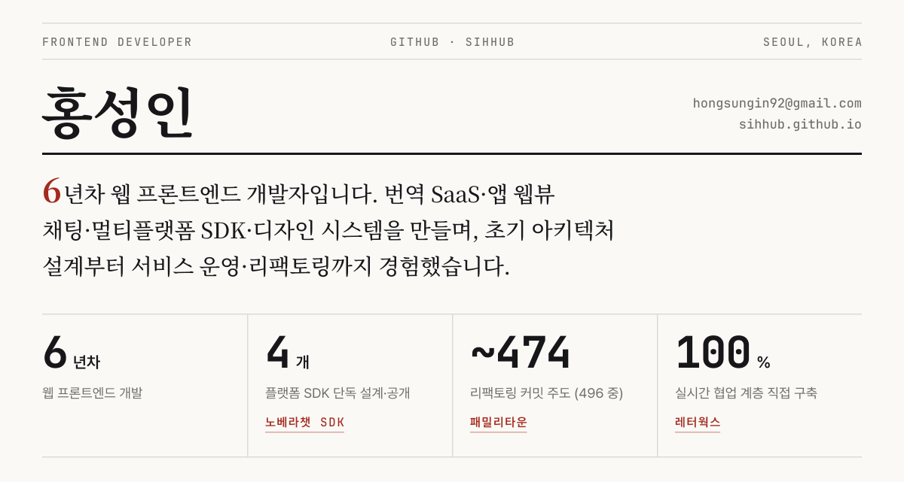

<picture>
  <source media="(prefers-color-scheme: dark)" srcset="./assets/masthead-dark.svg">
  
</picture>

<a href="https://sihhub.github.io/"><b>이력서 · 포트폴리오</b></a> &nbsp;·&nbsp;
<a href="https://sihhub.github.io/blog"><b>기술 블로그</b></a> &nbsp;·&nbsp;
<a href="mailto:hongsungin92@gmail.com">hongsungin92@gmail.com</a>

---

### 01 — 지금 만드는 것

**노베라챗 클라이언트 SDK** — 자체 채팅 서버를 감싸는 멀티플랫폼 클라이언트 SDK입니다. Web·React·Dart·Flutter 4개 패키지를 하나의 모노레포에서 개발하고, npm·pub.dev에 공개 배포합니다.

   

---

### 02 — 핵심 성과

1. **노베라챗 SDK** — 백엔드 수정 권한 없이 Web·React·Dart·Flutter 4개 패키지 모노레포로 채팅 SDK를 단독 설계·구현. JSON Schema 코드젠으로 TS·Dart 수동 미러링 지점 2→1. npm·pub.dev 3채널 자동 배포로 공개.
2. **패밀리타운** — 운영 중 코드베이스의 리팩토링 496커밋 중 \~474 주도. 핵심 파일 줄 수 −50\~84%, index.css −83%, 미사용 코드 \~915줄 제거.
3. **레터웍스** — 번역 SaaS 백엔드 개발자 공백기에 실시간 협업 계층 100% 직접 구축. AWS 서버리스 구성: API Gateway WebSocket + DynamoDB.

---

### 03 — 최근 글

<!-- BLOG-POST-LIST:START -->
- [숫자는 안 틀리고 문장이 틀린다 — 다 쓴 글 19편을 LLM에 다듬게 한 뒤 검증한 기록](https://sihhub.github.io/blog/posts/llm-polish-what-breaks/)
- [LLM은 어떻게 돌아가나 — 서버리스에서 안 되고, 브라우저에서는 되는 이유](https://sihhub.github.io/blog/posts/llm-inference-weights-gpu-browser/)
- [화면 하나 바꾸고 막힌 배포 — 1년 반 멈춘 파이프라인에서 썩어 있던 것들](https://sihhub.github.io/blog/posts/dormant-pipeline-rot/)
- [배포 이관은 왜 한 줄로 안 끝나는가 — Jenkins에서 Amplify로 옮기며 만난 벽 네 개](https://sihhub.github.io/blog/posts/deploy-migration-four-blockers/)
- [Figma를 토큰의 단일 출처로 — Variables REST API 없이 동기화 파이프라인 만들기](https://sihhub.github.io/blog/posts/design-system-figma-token-sync/)
<!-- BLOG-POST-LIST:END -->

블로그 피드에서 매일 자동으로 갱신됩니다.

---

### 04 — 기술

**주력** &nbsp; TypeScript · React · Next.js 
**상태 · 스타일** &nbsp; React Query · Zustand · Redux · Tailwind CSS · Storybook 
**크로스플랫폼 · 서버** &nbsp; Flutter · Dart · Node.js · AWS Lambda
