<picture>
  <source media="(prefers-color-scheme: dark)" srcset="./assets/banner-night.svg">
  
</picture>

번역 SaaS·앱 웹뷰 채팅·멀티플랫폼 SDK·디자인 시스템까지, 초기 아키텍처 설계부터 서비스 운영·리팩토링까지 경험한 6년차 웹 프론트엔드 개발자입니다.

  

<picture>
  <source media="(prefers-color-scheme: dark)" srcset="./assets/divider-night.svg">
  
</picture>

### 🟩 지금 만드는 것 — 노베라챗 클라이언트 SDK

자체 채팅 서버를 감싸는 멀티플랫폼 클라이언트 SDK입니다. Web·React·Dart·Flutter 4개 패키지를 하나의 모노레포에서 만들고 npm·pub.dev에 공개 배포합니다.

   

### 🟨 하이라이트

- 채팅 SDK를 Web·React·Dart·Flutter 4개 패키지 모노레포로 백엔드 수정 권한 없이 단독 설계·구현 — JSON Schema 코드젠으로 TS·Dart 손 미러링 지점 2→1, npm·pub.dev 3채널 자동 배포로 공개 (노베라챗 SDK)
- 운영 중 코드베이스 리팩토링 496커밋 중 \~474 주도 — 핵심 파일 라인 −50\~84%, index.css −83%, 미사용 코드 \~915줄 제거 (패밀리타운)
- 번역 SaaS 백엔드 개발자 공백기에 AWS 서버리스 실시간 협업 계층(API Gateway WebSocket + DynamoDB) 100% 직접 구축 (레터웍스)

### 🟫 최근 블로그 글

<!-- BLOG-POST-LIST:START -->
- [화면 하나 바꿨는데 배포가 안 됩니다 — 1년 반 배포가 멈춰 있던 파이프라인에서 썩어 있던 것들](https://sihhub.github.io/blog/posts/dormant-pipeline-rot/)
- [배포 이관은 왜 한 줄로 안 끝나는가 — 벽 네 개를 만난 기록](https://sihhub.github.io/blog/posts/deploy-migration-four-blockers/)
- [Figma를 토큰의 단일 출처로 — 공식 API가 막힌 자리에서 동기화 파이프라인 만들기](https://sihhub.github.io/blog/posts/design-system-figma-token-sync/)
- [로그가 거짓말을 할 때 — 관측을 오도한 두 사건](https://sihhub.github.io/blog/posts/misleading-logs-observability/)
- [IP 허용목록 하나 넣는 데 왜 네 번을 틀렸나 — CDN 뒤에서 클라이언트 IP 판별하기](https://sihhub.github.io/blog/posts/admin-ip-allowlist-behind-cdn/)
<!-- BLOG-POST-LIST:END -->

블로그 피드에서 매일 자동으로 갱신됩니다.

### ⬛ 기술

            

<picture>
  <source media="(prefers-color-scheme: dark)" srcset="./assets/divider-night.svg">
  
</picture>
